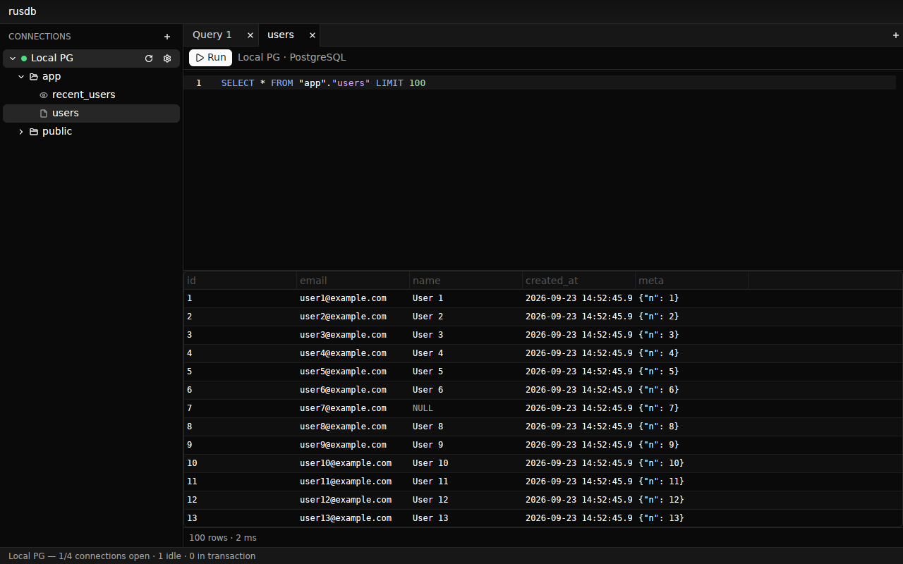

# rusdb

Fast, minimal database viewer for macOS. Rust + GPUI (Zed's UI framework).
PostgreSQL and MySQL. Design and decisions: [PLAN.md](PLAN.md).



## Quick start

```sh
make setup     # checks rustup, docker and (macOS) the Metal toolchain
make run-dev   # starts dev Postgres + MySQL with sample data and opens the app
```

`make run-dev` uses its own profile file (`target/dev-config/`) with two ready-made,
passwordless connections to the dev databases, so your real profiles stay untouched.
Use `make run` / `make run-release` for normal use.

Requirements:
- rustup (Rust 1.98.1 is installed automatically from `rust-toolchain.toml`, same as Zed).
- Docker (only for the dev databases).
- macOS: Xcode's Metal toolchain, which GPUI uses to compile shaders. Newer Xcode versions
  don't ship it by default: `xcodebuild -downloadComponent MetalToolchain`.

## Install

**From a release** (any of your Macs): download `rusdb-<version>-universal.dmg` from the
[GitHub releases](https://github.com/haenning/rusdb/releases), open it and drag rusdb
onto Applications. The app is only ad-hoc signed (no Apple Developer ID), so macOS blocks
the first start of a downloaded copy. Once: right-click rusdb in Applications → **Open** →
**Open**, or run `xattr -dr com.apple.quarantine /Applications/rusdb.app`.

**From source:** `make install` builds the app and copies it to `/Applications`.
`make dmg` only builds `target/bundle/rusdb.app` and the DMG (`UNIVERSAL=1` for Apple
Silicon + Intel). The icon is `packaging/macos/icon.png` (1024×1024).

Profiles, passwords and `local.db` live in `~/Library/Application Support/rusdb` and the
Keychain, per Mac. The first start of a newly built app asks once for Keychain access
to passwords saved by an earlier build ("Always Allow").

## Releases

1. Bump `version` in the workspace `Cargo.toml`, commit, merge.
2. Tag and push: `git tag v0.2.0 && git push origin v0.2.0`.
3. The Release workflow builds the universal DMG and publishes it as a GitHub release
   with generated notes. The tag has to match the `Cargo.toml` version.

## Using it

- The title bar switches database and user (like Zed's project and branch); the
  dropdowns also add and edit them. Passwords go to the macOS Keychain.
- Databases can be reached through an SSH tunnel (ssh-agent, key file or password).
- Click a table to query it; right-click for more. Right-click result rows to copy them
  or to open related rows via foreign keys.
- The bottom bar switches the sidebar between Schema, Bookmarks and History (click the
  active one, or `⌘B`, to hide it). Hover the status dot next to the user in the title
  bar for connection, SSH, pool and schema details.
- `⌘↵` runs the selection or the whole editor, `⌘D` bookmarks the query, `⌘T` new tab,
  `⌘W` close tab, `⌘B` toggle sidebar.

## Development

Run `make` to list all targets. The common ones:

| Target | What it does |
|---|---|
| `make db-up` / `db-down` / `db-reset` | Dev Postgres on `127.0.0.1:55432`, MySQL on `127.0.0.1:53306` (seed: `dev/seed/`) |
| `make psql` / `make mysql` | Shell into a dev database |
| `make test` | Unit tests |
| `make test-live` | Integration tests against the dev databases |
| `make lint` | rustfmt check, clippy (warnings as errors), cargo-deny, cargo-machete |
| `make tools` | Installs cargo-deny and cargo-machete |
| `make install` / `make dmg` | Build the macOS app (and DMG), see Install |
| `make ci` | Everything CI runs |

Lint rules shared by all crates are in `[workspace.lints]` (root `Cargo.toml`);
dependency policy (advisories, licenses, sources) is in `deny.toml`.

The dev databases use non-default ports bound to localhost, so they don't clash with a
local Postgres/MySQL.

Branches: work happens on `dev`; every push to `dev` opens (or updates) a pull request
into `main` (`.github/workflows/dev-pr.yml`). CI (`.github/workflows/ci.yml`: lint,
backend with live database tests on Linux, app build on macOS) is paused during heavy
development and only runs when started by hand (Actions → CI → Run workflow).

Linux builds (dev only) need `libxkbcommon-dev libxkbcommon-x11-dev`.

## License

[Apache-2.0](LICENSE)
