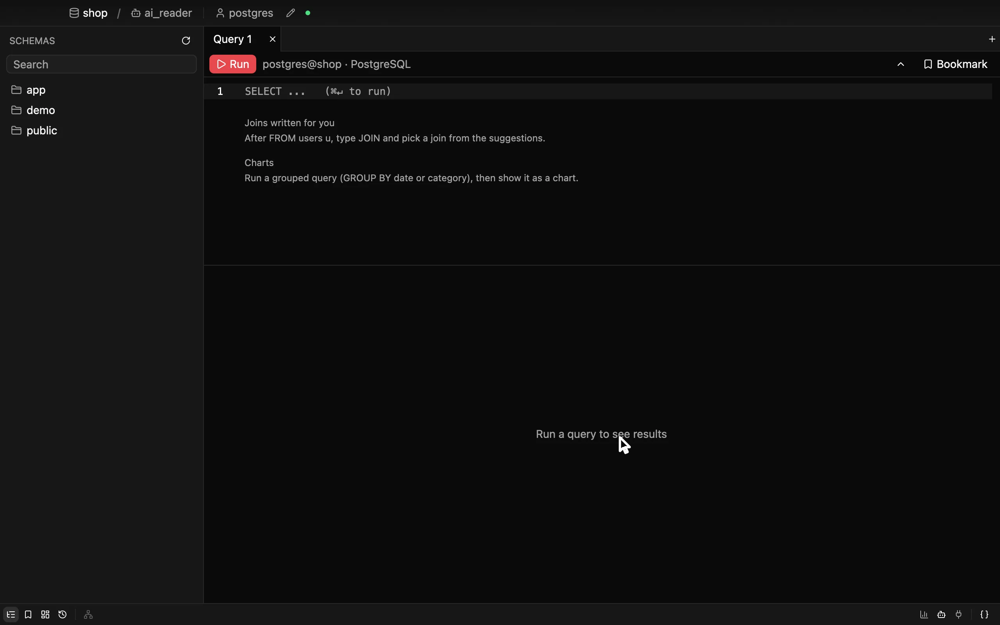

# tangul

**Ever wanted to detangul your data?**

Look at your data, understand it and find answers, on your own or with an AI that
can't break anything. Safe to point at production.

tangul is a native macOS app for PostgreSQL, MySQL and SQLite files. It starts instantly
and stays out of your way.

**[Install](INSTALL.md)** · **[Contribute](CONTRIBUTING.md)** · **[Roadmap](ROADMAP.md)** · **[Testing](docs/TESTING.md)** · **[Settings](docs/settings.md)**

## See your data

- **A fast result grid.** Only the visible cells are drawn, so large results scroll
  smoothly. NULL looks different from an empty string, and long values are cut in the
  grid instead of blowing up the layout.
- **Follow your foreign keys.** Right-click rows to open the rows they reference, or the
  rows that reference them. The three relations you use most come first; the rest are
  under *Show all*.
- **Charts from a query.** A grouped query becomes a chart in two clicks: lines, areas,
  stacked areas, bars side by side or stacked bars, for all columns or a single one,
  with a hover tooltip for exact values. Charts are a view of the result and are never
  stored.
- **Copy what you see.** Mark cells, rows or whole columns (click a column name; ⇧-click
  or drag for a rectangle, ⌘-click to take a row out or add it) and copy them, with
  headers if you like; the format pastes cleanly into spreadsheets. Copy as CSV, JSON,
  a Markdown table, INSERT statements or a list for `IN (…)`, or save them as a file:
  CSV, TSV, Excel, JSON, Markdown or INSERT statements. The column summary adds up
  the marked cells.
- **Schema at a glance.** Browse tables and views in the sidebar, click one to query it,
  and get query suggestions for it based on what you ran before.
- **Favorites.** Star the tables and views you use most; they stay on top of the
  sidebar for that database.

## Find answers faster

- **An editor that knows your schema.** Completion for tables, columns in scope and join
  conditions (from foreign keys and from joins you wrote before), ranked by what you
  actually use.
- **Errors before you run.** While you type, the server checks your statements without
  running them and underlines the exact spot it complains about.
- **History and bookmarks.** Every run is kept locally and searchable. Queries you
  repeat get a hint to bookmark them, and a bookmarked query shows its name when it
  runs.
- **Watch a query over time.** Schedule a bookmarked query (every 5 minutes up to once
  a day) and tangul runs it quietly in the background, read-only, and charts how long
  it took and how many rows it returned.
- **Command palette** (⌘⇧P) for bookmarks, history and settings.

## Investigate with AI

- **An assistant next to your data.** Ask in plain language in the chat on the right,
  or type a question into the editor and run it. The AI writes the SQL, runs it,
  follows your foreign keys and explains what it finds. Use your own key for
  Anthropic, OpenAI or any OpenAI-compatible service, or Gemini, or a local model with
  Ollama.
- **Results and charts in a tab.** When the AI has an answer, it opens it for you as
  the grid or a chart, without running the query again.
- **Boards by AI.** Ask for a board and the AI sets one up: tiles with their queries,
  shown as tables or charts. It can also change a board, but never removes tiles or
  links. A query whose plan looks heavy waits until you have run it yourself.
- **Your own AI tools too (MCP).** tangul runs an MCP server on your Mac (local only,
  with a token), so Claude Code or any other MCP client that speaks HTTP can use the
  same tools, with the same limits.
- **It can only read.** Its queries run one statement at a time, exactly as tangul
  checked them, in a read-only transaction that is always rolled back, so nothing it
  runs can change your data.
- **You approve every change.** Anything that would change data stops and waits for
  your click, exactly as written. The AI can't approve itself.
- **Its own database account.** Give the AI a user that may only read (the database
  form sets one up). The AI connects only as that user: if it can't, tangul tells you
  and never uses your account instead. Using your own account is allowed; the title
  bar says what that means.
- **Your grants are the boundary.** Whatever the AI's database user may select can
  reach the AI model you use, so limit that user to what the AI should see. An AI tool
  that can run commands or edit files on your Mac (Claude Code, for one) could also
  change tangul's `settings.json` and switch off read-only mode for your own users;
  only the database's grants hold against that.
- **Redact or hide columns.** Per database, say which columns the AI gets only as
  `⟦redacted⟧` or not at all (`..email`, `.orders.adr*`, whole tables), with
  exceptions (`"hide": [".", "!sales."]`). Renamed and computed columns count as the ones they come from.
  [How it works](docs/ai-view.md).
- **You can see what it ran.** Every AI query is logged locally, under `-- ai view`:
  run it again and you see exactly what the AI saw.

## Safe on production

- **Read-only mode per user.** Mark a login as read-only and the server session itself
  refuses writes, so a stray `UPDATE` can't get through even if the app's own checks
  miss it.
- **A second look before damage.** In read-only mode, a statement that changes data or
  schema never runs. tangul stops, shows it, and lets you switch read-only mode off;
  you then run it again as a separate step. An `UPDATE` or `DELETE` without a `WHERE`
  asks first too (on by default, in the settings).
- **Back to safe on its own.** Read-only mode can switch itself back on a while after
  your last change (`relock_after`, e.g. `"5m"`).
- **A time limit for every query.** Every statement stops after 60 seconds by default
  (`max_query_time`), enforced by the server and by tangul.
- **Nothing runs behind your back.** UPDATE and DELETE statements generated from
  selected rows open in a new tab, keyed by primary key, and wait for you to run them.
  Without a primary key the statement says so in a comment at the top.
- **Secrets stay in the Keychain.** Database passwords and SSH secrets go to the macOS
  Keychain, never into a config file.
- **SSH tunnels with verified host keys.** Connect through ssh-agent, a key file or a
  password. Unknown host keys show their fingerprint and ask; a changed key is refused.
- **TLS** for connections that need it (`prefer` / `require`). Certificate verification
  is on the roadmap.
- **Local and private.** No account, no telemetry. Profiles, history and bookmarks stay
  on your Mac. AI is opt-in, and it only sends what you ask about to the model you
  choose. The update check asks GitHub for the latest release and sends nothing else
  (off with `updates.check`).

## Light and fast

- **The UI never waits on the network.** Queries run on their own thread; the window
  keeps responding while a slow query streams in, and you can cancel it.
- **Gentle on your servers.** Connections open on first use, a tab only holds one while
  a statement runs, and idle connections close after a minute. One user with one tab
  uses exactly one server connection. An open transaction keeps its connection for that
  tab until you commit or roll back, and the tab shows it.
- **Sensible limits.** Results stream in batches and stop at 10,000 rows, so an
  accidental `SELECT *` on a huge table doesn't swamp your Mac.

## An explorer, not an admin tool

tangul shows you what is in your database. It does not design it.

- **No table designers, create table buttons, no schema editing.** Your schema
  belongs to your migration tool ([golang-migrate](https://github.com/golang-migrate/migrate),
  Flyway, Alembic, …) and to version control, not to a GUI.
- **No editing cells in the grid.** Changing data stays explicit SQL that you read before
  it runs.

These won't be added later. Leaving them out is what keeps tangul small, fast and safe
to point at production.

## Keyboard

| | |
|---|---|
| `⌘↵` | Run the selection, or the whole editor |
| `⌘T` / `⌘W` | New tab / close tab |
| `⌘D` | Bookmark the query |
| `⌘B` | Show or hide the sidebar |
| `⌘⇧P` | Command palette |
| `⌘,` | Settings (`settings.json` in a tab, `⌘S` saves; [all keys](docs/settings.md)) |

## Status

tangul is young and under active development. It runs on macOS (Apple Silicon and
Intel) and supports PostgreSQL, MySQL and SQLite files (read-only), with an AI assistant and an MCP server. Plans and
ideas are in the [roadmap](ROADMAP.md); requests are welcome as
[issues](https://github.com/haenning/tangul/issues).

## Built with

tangul is written in Rust on [GPUI](https://www.gpui.rs), the UI framework behind the
[Zed](https://zed.dev) editor. It is inspired by Zed, but not affiliated with, endorsed
by, or sponsored by Zed Industries.

## License

[AGPL-3.0-only](LICENSE). Contributions are accepted under the
[Contributor License Agreement](CLA.md).
